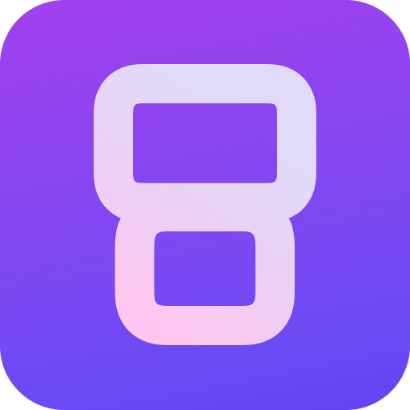

<p align="center">
  
</p>

# DualCPY for macOS

DualCPY for macOS mirrors both screens of an AYN Thor (and other supported
dual-screen Android handhelds) into two coordinated `scrcpy` windows. It keeps
the original project's profiles, wired/wireless ADB, layout presets, FPS
control, screenshots, gamepad forwarding, and file transfer.

The macOS port is open-source software under GPL-3.0. Apple Silicon is the
primary supported architecture; Intel Macs may run from source but are not part
of the automated release path yet.

This port is based on [DualCPY](https://github.com/theswest/DualCPY) and the
[DualCPY Linux port](https://github.com/DrSkyfaR/DualCPY-Linux).

## Download the app

Download the latest Apple Silicon archive from
[GitHub Releases](https://github.com/sofianeelhor/DualCPY-macOS/releases/latest),
unzip it, and move **DualCPY macOS.app** to Applications.

The free public build is ad-hoc signed but not Apple-notarized. On first launch,
macOS may require **System Settings → Privacy & Security → Open Anyway**. Install
the runtime dependencies once with:

```zsh
brew install android-platform-tools scrcpy
```

## Install from source

Requirements: macOS 13 or newer and [Homebrew](https://brew.sh).

1. Double-click `install.command` (or run `./install.command` in Terminal).
2. On the Thor, enable **Developer options → USB debugging**.
3. Connect it with a data-capable USB cable and accept the RSA authorization
   prompt on the Thor.
4. Double-click `run.command`.

The installer adds Homebrew `adb`, `scrcpy`, Python/Tk, and an isolated `.venv`.
It is safe to run again after an update.

Packaged releases still expect `adb` and `scrcpy` from Homebrew:

```zsh
brew install android-platform-tools scrcpy
```

To verify the setup without opening the UI:

```zsh
.venv/bin/python doctor.py
```

The packaged executable also supports `--version` and `--doctor` from Terminal.

## macOS permissions

- **Accessibility** (Terminal, or the packaged app): enables live position and
  size sliders. Initial window placement works without it.
- **Screen Recording**: required only for DualCPY's combined screenshot button
  and for streaming/recording applications such as OBS.

Open **System Settings → Privacy & Security** to change either permission.

## Streaming with OBS

Add two **Window Capture** sources and select `DualCPY Top Screen` and
`DualCPY Bottom Screen`. This is more reliable on macOS than capturing the
whole desktop and lets you crop/scale each display independently. Audio is
played by the top scrcpy window; capture that application audio in OBS or use
your preferred macOS audio-routing setup.

## Why there is no single embedded window

Windows and X11 allow one process to reparent another process's windows. macOS
does not provide a supported equivalent. This port instead arranges both native
scrcpy windows as a single canvas. They remain independently selectable by
streaming software and retain full mouse, keyboard, audio, and gamepad input.

## Troubleshooting

The Control Center shows startup/connection failures at the top. Click
**Open Logs** to open `~/Library/Application Support/DualCPY/logs`, then attach
`dualcpy.log` and the newest `scrcpy_top_*.log` / `scrcpy_bottom_*.log` to a bug
report. Redact device serials and IP addresses before posting them publicly.

- **`unauthorized` in `adb devices`:** unlock the Thor and accept its USB
  debugging prompt. If no prompt appears, revoke USB debugging authorizations,
  reconnect, and try again.
- **Only one screen:** run `scrcpy -s SERIAL --list-displays`. The built-in Thor
  profile expects display IDs `0` and `4`, but DualCPY also auto-detects them.
- **Layout sliders do nothing:** grant Accessibility permission, quit Terminal
  completely, reopen it, and start DualCPY again.
- **Screenshot is black or fails:** grant Screen Recording permission and
  restart DualCPY.
- **No device:** try another USB cable/port, or use the Wireless dialog after
  pairing Wireless debugging on Android.

## Development

```zsh
./install.command
make test
.venv/bin/python doctor.py
```

Useful targets are `make test`, `make build`, and `make package`. See
[CONTRIBUTING.md](CONTRIBUTING.md) before opening a pull request and
[docs/RELEASING.md](docs/RELEASING.md) for signing/notarization.
The one-time public-repository checklist is in
[docs/PUBLISHING.md](docs/PUBLISHING.md).

## Project status

- Tested on Apple Silicon with macOS 26 and an AYN Thor running Android 13.
- CI builds an arm64 `.app` on every pull request.
- Tag builds create draft GitHub releases with checksums.
- Public binaries should be Developer ID signed and Apple-notarized. Without
  signing credentials, the workflow deliberately labels the archive unsigned.

See [SECURITY.md](SECURITY.md), [SUPPORT.md](SUPPORT.md), and [NOTICE.md](NOTICE.md)
for reporting and attribution details.

DualCPY is GPL-3.0. `scrcpy` is Apache-2.0 and is installed unmodified through
Homebrew.
